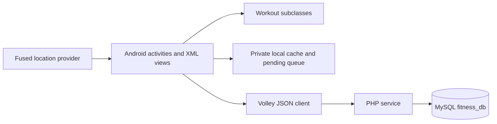
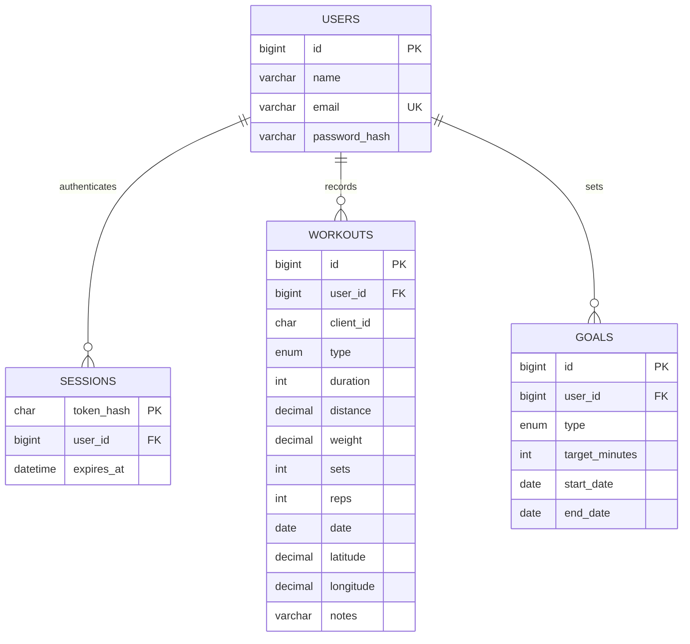

# Fitness Tracker specification

## Screens and interaction flow

Sign in → dashboard with History, Goals and Progress tabs. Registration is available from sign in. The dashboard + button opens the workout form from History and the goal form from Goals. A workout row opens a detail dialog with Edit and Delete actions. Back returns to the dashboard. Sign out returns to authentication.

The main action is placed at the bottom right. Form labels include units. Strength fields replace distance for weightlifting, reducing irrelevant inputs. Empty states explain what to do next. Save errors stay visible and allow retry. Location permission is requested only after the user taps the location action.

## Architecture

The authenticated PHP service derives the current user's ID from a bearer token. It never trusts a client-provided user ID. SQL statements use bound parameters. Expired sessions are rejected. The public web directory excludes configuration files.

## Data relationships

The unique `(user_id, client_id)` constraint makes offline upload retries idempotent. `(user_id, date)` supports workout-history queries. Foreign keys cascade account deletion to dependent records. Goals reference the user and are matched to workouts by activity and date interval.

## Inputs and validation

| Input | Rule |
|---|---|
| Account | Name required, email valid and unique, password 8–72 bytes |
| Activity | Running, Cycling, Weightlifting or Walking |
| Duration | Whole minutes from 1 to 1,440 |
| Distance | Required for running/cycling/walking, 0.01–99,999 km |
| Strength | Weight 0.01–99,999 kg, sets and repetitions each 1–1,000 |
| Workout date | Valid date from 2000 onwards, not a future completed session |
| Location | Optional latitude −90 to 90 and longitude −180 to 180, supplied together |
| Notes | Optional, server limit 500 UTF-8 bytes |
| Goal | Supported activity, target 1–100,000 minutes, valid inclusive date range |

Server validation is authoritative. The app also validates inputs for immediate feedback. The limits are data-entry bounds, not exercise recommendations.

## Offline and reliability behaviour

New workouts enter a durable local queue before navigation back to the dashboard. The dashboard uploads them sequentially, persists successful responses in its cache, and removes acknowledged pending entries. A stable UUID prevents duplicate rows if the response is lost after insertion. Cache and queue keys include both server address and user ID. Signing out preserves pending entries for the same account; other accounts do not see them.

If the service cannot be reached, the dashboard shows cached data and pending state. Invalid pending records remain visible instead of being silently discarded and can be deleted. Editing and deletion are online operations. Authentication expires after seven days. Rotation restores form inputs and saved date/location state.

## Scope

The implementation includes an extra walking activity and computed pace, speed, training volume and week-to-week insights. It does not include push notifications, continuous route tracking, wearable integration, or synchronization while closed. The report should distinguish these implementation limits from general mobile-app capabilities discussed in Task 1.
